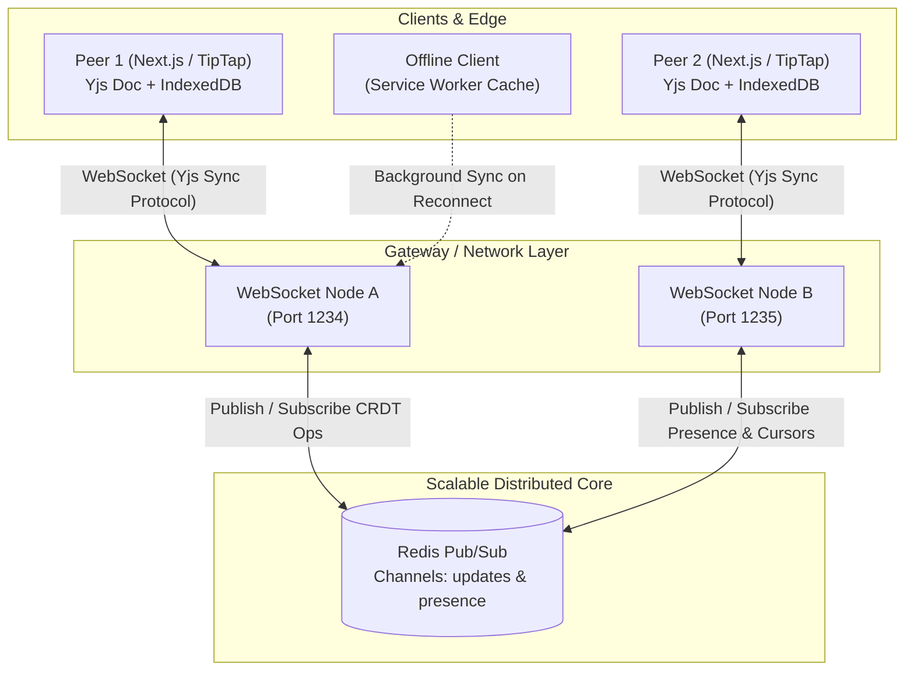

# SyncPad — Real-Time Collaborative Editor

[](https://www.typescriptlang.org/)
[](https://nextjs.org/)
[](https://yjs.dev/)
[](https://redis.io/)
[](LICENSE)

> **Distributed, conflict-free collaborative text editor for concurrent multi-user editing, powered by Yjs (CRDTs) over WebSockets, Redis Pub/Sub presence clustering, offline-first IndexedDB persistence, and client-side DOM block virtualization.**

---

## 🌟 Key Highlights & Features

- **Conflict-Free Collaborative Editing (Yjs CRDTs):**
  - Uses state vectors and conflict-free replicated data types over WebSockets to ensure mathematical replica convergence without central document locking.
  - Multi-user concurrent text insertion, deletion, and formatting.
  - Independent client-side CRDT Undo/Redo managers that preserve non-conflicting remote peer operations.

- **Low-Latency Presence Layer & Redis Pub/Sub:**
  - Real-time live cursor tracking, selection range highlights, and typing activity badges.
  - Broadcasted across multiple WebSocket server instances via Redis Pub/Sub channels (`syncpad:presence:*` and `syncpad:crdt:*`).
  - Seamless automatic fallback to an in-memory cluster bus if Redis is not locally configured.

- **Offline-First Durability & Background Sync:**
  - Full client-side document persistence via `y-indexeddb` and Service Worker (`sw.js`).
  - Allows full document creation and editing during network drops or in airplane mode.
  - Automatically merges offline mutations conflict-free via 3-way CRDT state vector exchange upon reconnection.

- **Client-Side Scalability & Text Block Virtualization:**
  - Eliminates DOM recalculation lag during heavy concurrent typing bursts by leveraging CSS `content-visibility: auto` and `contain-intrinsic-size` on large paragraphs and text blocks.
  - Skips offscreen layout passes while maintaining instant searchability and document continuity.

- **Integrated Split-View Multi-Peer Simulator:**
  - Built-in one-click **"Split-View Demo"** allows testing simultaneous concurrent multi-user editing directly in one browser window without opening a second computer or incognito tab.

- **Real-Time CRDT Diagnostics HUD:**
  - Live floating HUD tracking RTT WebSocket ping latency, CRDT state vector byte sizes, inbound/outbound vector update counts, and offline status.

- **Document Export & Customization:**
  - Instant export to HTML, Plain Text, and JSON CRDT snapshots with celebratory animations.
  - Customizable collaborator name and cursor color palette.

---

## 🏛️ System Architecture



---

## 🚀 Quick Start

### 1. Prerequisites
- **Node.js** v18+ or v20+
- **pnpm** (or npm / yarn)
- Optional: **Redis** (if not running, SyncPad automatically operates via its built-in in-memory cluster bus)

### 2. Installation

```bash
# Clone the repository
git clone https://github.com/Rythmon/SyncPad.git
cd SyncPad

# Install dependencies
pnpm install
```

### 3. Environment Setup

Create `.env` based on `.env.example`:

```bash
cp .env.example .env
```

Configuration variables:
```env
# WebSocket Server
WS_PORT=1234
REDIS_URL=redis://127.0.0.1:6379

# Next.js Frontend
NEXT_PUBLIC_WS_URL=ws://localhost:1234
```

### 4. Running the Development Environment

Run both Next.js frontend (`:3000`) and the WebSocket gateway (`:1234`) with a single command:

```bash
pnpm dev
```

Visit [http://localhost:3000](http://localhost:3000) in your browser!

---

## 🐳 Running with Docker Compose

Spin up Redis, the Node.js WebSocket Gateway, and the Next.js Frontend together in Docker:

```bash
docker-compose up --build
```

- Web UI: `http://localhost:3000`
- WebSocket Server: `ws://localhost:1234`
- Health check: `http://localhost:1234/health`
- Redis: `localhost:6379`

---

## 🔬 How Concurrent Conflict Resolution Works

SyncPad relies on **Yjs Conflict-Free Replicated Data Types (CRDTs)**:
1. Every character and text block is identified by an immutable `(client, clock)` unique tuple.
2. When Peer A and Peer B type simultaneously at the exact same index:
   - Rather than utilizing a centralized lock or operational transform server, the CRDT deterministically orders the characters based on their unique client identifiers and logical timestamps.
   - Operations commute: $A \circ B = B \circ A$. Both peers converge on the exact same document state without data loss.
3. When network dropouts happen:
   - Local edits are written directly to the local replica and persistent `IndexedDB`.
   - On reconnect, the client sends its **State Vector** (`syncStep1`), the server calculates the missing delta (`syncStep2`), and both states reconcile seamlessly in milliseconds.

---

## 📁 Repository Structure

```
syncpad/
├── src/
│   ├── app/
│   │   ├── layout.tsx                # Next.js root layout & PWA meta
│   │   ├── page.tsx                  # Home room route
│   │   ├── globals.css               # TipTap typography, cursors & virtualized styles
│   │   └── doc/[id]/page.tsx         # Dynamic collaborative document rooms
│   ├── components/
│   │   ├── DocumentRoomView.tsx      # Main collaborative controller view
│   │   ├── Editor/
│   │   │   ├── CollaborativeEditor.tsx # TipTap + Yjs collaboration component
│   │   │   └── EditorToolbar.tsx     # Rich formatting controls & virtualization switch
│   │   ├── Presence/
│   │   │   ├── ActiveUsersBar.tsx    # Live collaborator avatars & typing indicators
│   │   │   └── LivePresenceHUD.tsx   # Real-time CRDT & latency diagnostics HUD
│   │   ├── Navigation/
│   │   │   └── Navbar.tsx            # Header with synced title & room actions
│   │   ├── Offline/
│   │   │   └── OfflineBanner.tsx     # Offline mode alert & reconnection CTA
│   │   ├── Simulation/
│   │   │   └── SplitViewSimulator.tsx# Side-by-side multi-peer live testing frame
│   │   └── Modals/
│   │       ├── ProfileModal.tsx      # Name & cursor color customizer
│   │       ├── ExportModal.tsx       # Export to HTML, TXT, JSON snapshot
│   │       └── ShareModal.tsx        # Multi-tab room share modal
│   ├── hooks/
│   │   └── useCollaboration.ts       # Unified Yjs, WebSocket & IndexedDB hook
│   └── lib/
│       ├── colors.ts                 # Collaborator color palettes
│       ├── service-worker.ts         # SW registration & Background Sync API
│       └── utils.ts                  # Classnames & byte formatting utilities
├── public/
│   ├── sw.js                         # Service worker offline caching & background sync
│   └── manifest.json                 # Web app manifest
├── server/
│   ├── index.ts                      # Server bootstrap & graceful shutdown
│   ├── redis-pubsub.ts               # Redis Pub/Sub manager with cluster fallback
│   ├── room-manager.ts               # Y.Doc room replicas & Yjs sync protocol
│   ├── presence-layer.ts             # Low-latency cursor and selection broadcaster
│   ├── websocket-server.ts           # HTTP & WebSocket gateway with heartbeats
│   └── types.ts                      # Server interfaces & message wire protocols
├── docker-compose.yml                # Multi-container orchestration (Redis + Gateway + Web)
├── Dockerfile.server                 # WebSocket server container image
├── Dockerfile.web                    # Next.js frontend container image
├── package.json                      # Dependencies and unified scripts
└── README.md                         # Documentation
```

---

## 🛡️ License

MIT License. Designed and engineered for production-grade real-time collaborative editing.
